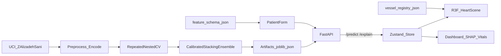
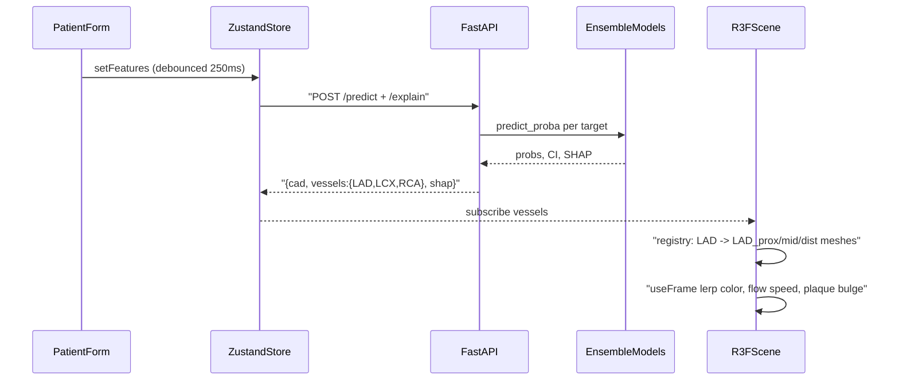

# Vascora - CAD Risk 3D Visualization Plan

## 0. Repo layout

```
Vascora/
  README.md              # this plan + setup/usage (first deliverable)
  ml/                    # training pipeline (Python 3.12 via uv; 3.14 lacks wheels for shap/catboost)
    data/                # raw xlsx from UCI (id 412) - gitignored, download script
    src/ (preprocess.py, features.py, models.py, train.py, evaluate.py, explain.py)
    artifacts/           # model .joblib, calibrators, metrics.json, shap background, feature_schema.json
    reports/             # ROC/PR/calibration plots for docs
  backend/               # FastAPI: loads artifacts, serves predictions + SHAP
  frontend/              # Vite + React + TS + R3F + drei + postprocessing + zustand + Tailwind/shadcn + Recharts
    public/models/       # heart.glb, torso.glb (Draco/meshopt + KTX2)
  assets-pipeline/       # Blender file + gltf-transform scripts + licenses/attribution
  docs/                  # 6-page report, demo video script
  shared/                # feature_schema.json, vessel_registry.json (contracts used by ml, backend, frontend)
```



## 1. Predictive modeling (30% - "best AI")

Dataset: 303 patients, ~55 features, labels `LAD`, `LCX`, `RCA` (Stenotic/Normal), `Cath` (Cad/Normal). Small n means validation rigor matters more than model size.

- **Leakage guard**: drop `LAD`, `LCX`, `RCA`, `Cath` from X for every task; assert in code + unit test.
- **Preprocessing**: binary Y/N -> 0/1, Sex/categorical (`BBB`, `VHD`, `Region RWMA`, `Function Class`) one-hot or ordinal; engineered features (pulse pressure, non-HDL, TG/HDL, LDL/HDL, risk-factor count, Framingham-style score). All fitted inside CV folds (sklearn `Pipeline`).
- **Candidate models** per target: L1/ElasticNet LogReg, SVM-RBF, RandomForest, ExtraTrees, XGBoost, LightGBM, CatBoost, **TabPFN v2** (SOTA on small tabular, likely top performer). Optuna tuning inside inner folds.
- **Multi-label strategy**: compare independent binary vs **classifier chain** (CAD -> LAD -> LCX -> RCA, chain uses predicted probs, not true labels) - vessel labels are correlated; pick best by CV.
- **Final model**: stacking/soft-vote of top 3-4 base models + **probability calibration** (isotonic/Platt, CV) so colors on heart reflect real probabilities. Per-target threshold tuned for Youden J / F1 (shown in UI).
- **Validation**: repeated stratified nested CV (5x5 outer, 10 repeats) + one held-out 20% test set reported separately. Metrics: accuracy, precision, recall, F1, ROC-AUC, PR-AUC, Brier, calibration curve, 95% bootstrap CIs, McNemar/DeLong vs baseline LogReg. Export `metrics.json` consumed by dashboard "Model Performance" tab.
- **Uncertainty**: spread across CV-fold models -> per-prediction interval displayed.
- Literature baseline: CAD accuracy ~90%+ achievable; vessel-level ~70-80% - set honest targets.

## 2. Explainability (20%)

- SHAP: `TreeExplainer` for GBMs, `shap.Explainer` (permutation) for ensemble/TabPFN with fixed background sample (k-means 50) cached for speed (<300 ms per request).
- Per-target local explanations (CAD + each vessel), global beeswarm/importance precomputed at train time.
- Map one-hot features back to clinical names; group into categories (Demographic, Vitals, Labs, ECG, Echo) for "physiological breakdown".
- Optional LIME as cross-check view; counterfactual "what would lower risk" hints (DiCE-lite: perturb modifiable features).

## 3. Backend (FastAPI)

- `GET /schema` (feature_schema.json: name, type, unit, normal range, category, modifiable flag) - form auto-generated from it -> new features need no UI redesign.
- `POST /predict` -> `{cad:{prob,label,ci}, vessels:{LAD,LCX,RCA}}`; `POST /explain` -> SHAP per target; `GET /metrics`; `GET /samples` (anonymized test-set patients as presets).
- Pydantic validation, model registry pattern (`models/{target}.joblib`) so new targets plug in.

## 4. 3D visualization (25% - "very realistic, minute detail")

**Assets** (CPU-friendly but photoreal):

- Heart visual: high-detail CC-BY textured heart from Sketchfab (PBR albedo/normal/roughness, 4k -> baked to 2k KTX2). Verify license, credit in README.
- Anatomically correct coronaries: extract LAD, LCX, RCA (+ left main, diagonals, OM, PDA) from **Z-Anatomy / BodyParts3D** (CC-BY-SA), align to heart in Blender, split into proximal/mid/distal segments, name meshes `LAD_prox`, etc. Fallback: hand-authored `CatmullRomCurve3` -> `TubeGeometry` with tapering radius.
- Torso: translucent body shell + ribcage from Z-Anatomy, decimated.
- Pipeline: Blender -> glTF -> `gltf-transform` (meshopt/Draco, KTX2, dedup, LODs). Budget: heart <150k tris, total <8 MB.

**Rendering (R3F + drei + @react-three/postprocessing)**:

- Myocardium: `MeshPhysicalMaterial` (clearcoat for wet look, sheen, normal map, subtle `transmission/thickness` fake SSS) or custom wrap-lighting SSS shader.
- Studio HDRI `Environment`, soft contact shadows, ACES/AgX tone mapping.
- Post: N8AO (ambient occlusion), subtle Bloom on high-risk emissive vessels, SMAA, vignette, DOF on focus.
- **Heartbeat**: vertex-shader systole/diastole displacement (or morph targets if asset has them) at patient heart rate (`PR` feature), ~70 bpm default.
- **Blood flow shader** on coronaries: scrolling pulse along tube UVs; flow slows/thins and color shifts at predicted stenotic vessels; narrowing "plaque" bulge at mid segment scaled by probability.
- Torso: Fresnel/x-ray shader shell, toggleable.

**Risk mapping**:

- `vessel_registry.json`: `{ "LAD": {meshes:["LAD_prox","LAD_mid","LAD_dist","D1"], territory:"anterior", label:"..."} }` -> guaranteed model-output <-> mesh correspondence; new structures = registry entry.
- Color: perceptual ramp (green -> amber -> red, viridis-safe alt for color-blind) on `emissive` + base color, animated via `useFrame` lerp when predictions change.
- Optional myocardial territory overlay (anterior/lateral/inferior) tinted by vessel risk; RWMA region highlighted separately labeled "echo finding, not lesion map".

**Interaction**: `CameraControls` orbit/zoom/pan, raycast hover outline (`@react-three/postprocessing` Outline/Select), click vessel -> camera fly-to + side panel (prob, CI, top SHAP drivers for that vessel), `Html` labels, view presets (Anterior/Posterior/Left/Right), x-ray/explode toggles.

**Performance (no dedicated GPU)**: `PerformanceMonitor` + `AdaptiveDpr`, quality tiers (disable AO/bloom on low), LODs, `frameloop="demand"` when idle and animation paused, instanced meshes, lazy load GLB with Suspense progress.

## 4b. ML -> 3D connection (data flow)



- Contract: target keys `LAD`/`LCX`/`RCA` are the same strings in model registry, API response, `vessel_registry.json`, and GLB mesh name prefixes. One ID end-to-end = guaranteed correspondence.
- Mapping per vessel: `prob -> colorRamp(prob)` (base + emissive), `prob -> flowSpeed = 1 - 0.7*prob`, `prob > threshold -> plaque bulge + pulse glow`, `CI width -> shimmer/uncertainty halo`. `PR` (pulse rate) feature drives heartbeat speed.
- Reverse direction: clicking a vessel mesh -> `selectedVessel` in store -> dashboard shows that target's SHAP waterfall.
- Scene never calls the API; it only reads store. ML swap/new vessel = backend artifact + registry entry, no scene rewrite.

## 5. Clinical dashboard (UI)

Layout: left = patient input (schema-driven form, presets, sliders for what-if with debounced live re-predict ~250 ms), center = 3D canvas, right = results.

- CAD gauge + label + CI; 3 vessel cards (prob bar, threshold marker).
- SHAP waterfall per selected target; grouped category breakdown; vitals table with value, normal range, out-of-range flags, contribution.
- Model Performance tab: ROC/PR/calibration charts, confusion matrices from `metrics.json`.
- Export PDF report (patient summary + screenshot of heart).
- **Disclaimer**: persistent top banner + first-load modal acknowledgment + footer on PDF: "Decision support / educational only. Not a substitute for coronary angiography or formal diagnostic imaging."

## 6. Deliverables & docs

- No Docker: run locally with `uv run uvicorn app.main:app` (backend) and `npm run dev` (frontend); `uv run python -m src.train` in `ml/` reproduces artifacts (fixed seeds).
- Tests: leakage test, schema test, API contract test.
- 6-page doc: data/preprocessing, models + validation, results table, explainability, 3D pipeline, usage.
- Demo video (3-10 min) script: problem -> input patient -> live 3D update -> vessel click -> SHAP -> what-if -> metrics -> architecture.

## 7. Phasing

1. Day 1: README, data download, EDA, baseline models + leakage-safe CV.
2. Day 1-2: full model zoo, TabPFN, chains, calibration, SHAP, artifacts.
3. Day 1-3 (parallel): asset pipeline in Blender, R3F scene, shaders, vessel registry.
4. Day 3: FastAPI + dashboard integration, what-if, disclaimer.
5. Day 4: polish visuals/perf tiers, docs, video.

## Task checklist

- [ ] Create README.md in repo root containing this plan, setup steps, licenses/attribution section
- [ ] Scaffold monorepo: ml/ (uv, Python 3.12), backend/ (FastAPI), frontend/ (Vite React TS R3F), shared/ contracts
- [ ] Download Z-Alizadeh Sani dataset, preprocess, EDA, feature_schema.json, leakage guard + test
- [ ] Nested repeated CV model zoo (LogReg, RF, ET, XGB, LGBM, CatBoost, TabPFN) with Optuna, for CAD/LAD/LCX/RCA; compare independent vs classifier chain
- [ ] Stacking ensemble + calibration + threshold tuning + bootstrap CIs; export artifacts and metrics.json + plots
- [ ] SHAP explainers per target with cached background, grouped categories, global importance, counterfactual hints
- [ ] FastAPI endpoints /schema /predict /explain /metrics /samples with Pydantic + model registry
- [ ] Asset pipeline: Sketchfab CC-BY heart + Z-Anatomy coronaries/torso, align in Blender, segment-named meshes, gltf-transform compress + LOD
- [ ] R3F scene: physical myocardium material, HDRI, AO/bloom/SMAA, heartbeat shader, coronary blood-flow shader, x-ray torso
- [ ] vessel_registry.json mapping, risk color ramp with animated transitions, stenosis bulge, hover/select/fly-to, labels, view presets
- [ ] Dashboard: schema-driven form, presets, what-if sliders live re-predict, CAD/vessel cards, SHAP waterfall, vitals breakdown, metrics tab, PDF export
- [ ] Persistent disclaimer banner + first-load modal + PDF footer
- [ ] Performance tiers: PerformanceMonitor, AdaptiveDpr, LODs, demand frameloop; test on integrated GPU
- [ ] 6-page documentation, evaluation results, demo video script and recording
